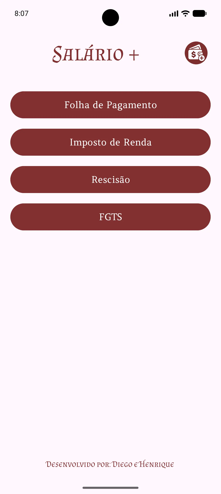

# Desenvolvimento do Site de Aplicativo

---
Desenvolvido para **Programação para Dispositivos Móveis** - **IFRS 2026 / 4° ano**

Veja mais em: <https://github.com/diegooilv/IFRS2026>

---

Desenvolvimento de uma interface web para apresentação e divulgação do aplicativo, com foco na identidade visual, organização das informações, acessibilidade e experiência do usuário.

O site foi estruturado para apresentar as principais funcionalidades do aplicativo, seus objetivos e os recursos disponibilizados, proporcionando aos visitantes uma visão clara de sua proposta e utilidade.

---

**Utilização de Inteligência Artificial:** ferramentas de IA foram utilizadas como apoio ao processo de desenvolvimento, especialmente na exploração de referências visuais, aprimoramento da estilização e otimização da construção da interface. As decisões de implementação, adaptações e ajustes foram realizados conforme as necessidades e a identidade visual do projeto.